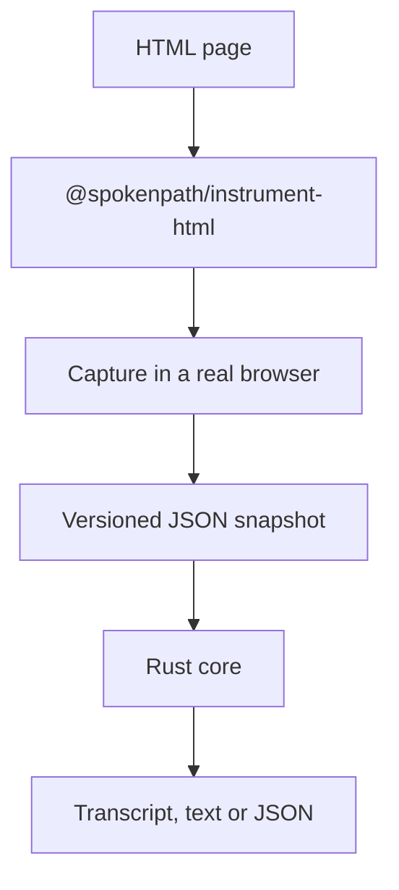

# spokenpath

[](https://github.com/nickvirden/spokenpath/actions/workflows/ci.yml)
[](#licence)
[](https://scorecard.dev/viewer/?uri=github.com/nickvirden/spokenpath)

spokenpath is designed to show what a real browser exposes to screen readers on a web page, line by
line and traced back to the HTML that produced it, so you can review it without running a screen
reader.

## Status

spokenpath is **pre-alpha**. Nothing is installable yet and no package is published. Versions stay
at 0.x until 1.0 is declared on purpose, and one version covers the whole repository.

## Example

This example is a **design target: spokenpath does not produce this output yet.** It shows the
shape the transcript is being built towards. Real output will come from tested fixtures, and this
example will be replaced by one of them.

Given this page, `form.html`:

```html
<main>
  <h1>Sign in</h1>
  <form>
    <label for="email">Email</label>
    <input id="email" type="email" required>
    <button type="button"><svg aria-hidden="true" viewBox="0 0 16 16"><path d="M2 8h12"/></svg></button>
    <button type="submit">Sign in</button>
  </form>
</main>
```

the transcript is designed to look like this:

```text
spokenpath 0.1.0 · snapshot v0 · Chromium <version> · viewport 1280x720
A = exposed by Chromium   ~ = illustrative speech, approximate, not any specific screen reader

 1  A main                                         form.html:1:1   <main>
    ~ "main"
 2  A heading "Sign in"  level 1                   form.html:2:3   <h1>
      name from contents
    ~ "Sign in, heading level 1"
 3  A textbox "Email"  required focusable          form.html:5:5   <input id="email" type="email" required>
      name from <label for="email"> (form.html:4:5)
    ~ "Email, edit text, required"
 4  A button (no accessible name)  focusable       form.html:6:5   <button type="button">
      name: contents empty; <svg> excluded (aria-hidden, form.html:6:27); no aria-label or title
    ~ "button"
 5  A button "Sign in"  focusable                  form.html:7:5   <button type="submit">
      name from contents
    ~ "Sign in, button"

Headings   [2] h1 "Sign in"
Tab order  1 -> [3]  2 -> [4]  3 -> [5]   (3 stops, no cycle)
```

Lines tagged `A` are what Chromium exposes. Lines tagged `~` are illustrative speech, approximate.
Node 4 is a button with no accessible name: its only content is an icon hidden with
`aria-hidden`, and the transcript says where the empty name comes from.

## What it is

spokenpath is designed to load a page in a real browser, record what the browser exposes, and
print it as a transcript in which every line says where it came from.

- **Layer A, "what the browser exposes".** For each node: its role, name, description and states,
  why a node is excluded from the accessibility tree, and where its name came from (for example a
  `<label>`, `aria-label` or the element's contents). Layer A is labelled with the browser engine
  and version it was captured from. Values the tool computes itself are labelled "computed by
  tool".
- **Layer B, "illustrative speech, approximate".** A neutral phrase per node that suggests how the
  exposed data might be spoken. It is always marked approximate, kept under `approx` in JSON
  output, and removable with `--no-speech`. Phrasing attributed to a real screen reader is planned
  only for patterns backed by captured speech, with the versions stated.
- **Source tags.** Each line is traced to the tag in your HTML that produced it, as
  `file:line:column`.
- **Navigation.** Indexes of headings, landmarks, links and form controls, and the tab order found
  by pressing Tab in the browser.

None of this is shipped yet; the [roadmap](docs/roadmap.md) lists the order it is being built in.
The design is recorded in [ADR-0001](docs/decisions/ADR-0001-two-layer-output.md).

## What it is not

spokenpath is not a screen reader, and it is not a substitute for testing with real screen readers
and with the people who use them. It is not a rule checker or a conformance tool, and it makes no
WCAG or other conformance claim. Its output does not reproduce what a screen reader says or what
users experience.

Specifically:

- **Exact only for the named browser build.** Layer A is what one browser version exposes,
  including that browser's bugs. It is not claimed to conform to the specifications.
- **Chromium's tree is Blink's internal tree**, not the platform accessibility API that screen
  readers read (UIA, IA2, the macOS accessibility API, ATK).
- **Safari's tree is the macOS accessibility tree as read by a helper** process, which is close to
  what VoiceOver consumes but is still read from outside VoiceOver.
- **VoiceOver phrasing is shown only for captured patterns** on the stated macOS, Safari and
  VoiceOver versions, and real speech depends on verbosity and other user settings.
- **iOS is not covered.**
- **One moment in time.** A capture is a single snapshot of the page: no live regions and no
  dynamic updates.
- **Script-created and implied elements are unmapped**: they have no source location, and the
  output says so.
- **No iframes.**
- **Captured pages execute their scripts**, because capture loads them in a real browser. Capture
  only pages you trust (see [Security](#security)).
- **Output can change between browser and macOS versions**, which is why every transcript names
  the versions it came from.

## How it works



The same pipeline, step by step:

1. **Instrument.** `@spokenpath/instrument-html` uses a parser to find each start tag and splices a
   source-location attribute into the original text. The page is never re-serialised, and the
   instrumented page's DOM is checked to be equal to the original's apart from that attribute.
2. **Capture.** A real browser loads the instrumented page. Capture records the raw DOM, the raw
   accessibility tree and a real Tab-key focus walk, and interprets nothing.
3. **Snapshot.** Capture writes everything into a versioned JSON snapshot labelled with the engine,
   its version and the viewport.
4. **Rust core.** A per-engine adapter reads the snapshot into an engine-neutral model, and the
   core works out reading order and the navigation indexes.
5. **Transcript.** The core renders the result as text or JSON.

The reasons for this design are in
[ADR-0002](docs/decisions/ADR-0002-browser-ground-truth-and-rust-core.md) and
[ADR-0003](docs/decisions/ADR-0003-source-tagging-by-splicing.md).

## How it compares

Each of these tools does something spokenpath does not, and most of them work today. spokenpath's
side of each comparison describes its design, not a shipped product. The
[market landscape research](docs/research/market-landscape.md) has the full table, with sources and
the date each fact was read.

- **[axe-core](https://github.com/dequelabs/axe-core)** is a rule engine: it finds rule violations
  in a page. spokenpath does not check rules at all. It shows what the browser exposes, and
  leaves rule checking to tools like axe-core.
- **[Guidepup](https://github.com/guidepup/guidepup)** drives real screen readers (VoiceOver on
  macOS, NVDA on Windows, Orca on Linux) and produces their real output. spokenpath runs no screen
  reader; its speech layer is illustrative unless backed by captured speech.
- **[Guidepup's `virtual-screen-reader`](https://github.com/guidepup/virtual-screen-reader)**
  walks the DOM and emits spoken-phrase logs inside Jest and Playwright-style tests. It runs in
  tests today and is widely used. Its output is one generic phrasing, its README says it is not a
  substitute for testing with real screen readers, and it has no source mapping. spokenpath reads
  the accessibility tree from a real browser and traces each line to its source tag.
- **[`@reticular/speakable`](https://github.com/R3TICULAR/AnnounceKit)** predicts what NVDA, JAWS,
  VoiceOver and Narrator would announce from static HTML, through jsdom and per-reader renderers.
  It ships those renderers, a CLI, an MCP server and a Storybook add-on. It describes itself as
  heuristic and publishes no validation against real screen readers. spokenpath uses a real
  browser as its source and shows per-reader phrasing only where captured speech backs it.
- **[Playwright ARIA snapshots](https://playwright.dev/docs/aria-snapshots)** are built into the
  Playwright test runner: a YAML view of the accessibility tree that `toMatchAriaSnapshot` compares
  in tests. They show a tree, not announcements, and cannot map back to source. spokenpath adds
  where each name came from, the source tag, and the browser version.

## Roadmap

Next comes the groundwork (workspaces, probes and the snapshot schema), then source tagging, a
Chromium slice through to a command-line tool, and then Safari and a VoiceOver speech profile on
macOS. The [roadmap](docs/roadmap.md) lists the ordered work and the later items.

## Versioning and releases

- Every commit message and pull request title is a
  [Conventional Commit](https://www.conventionalcommits.org/).
- Pull requests are squash-merged, and the pull request title becomes the commit subject on `main`.
- Every push to `main` runs [semantic-release](https://github.com/semantic-release/semantic-release),
  which tags and publishes a GitHub release when the commits since the last tag warrant one.
- While the version is 0.x, `feat` and breaking changes cut a minor release, `fix`, `perf` and
  GitHub-style reverts cut a patch release, and other types cut none. The
  [contributing guide](CONTRIBUTING.md#commits-and-pull-request-titles) has the full table.
- One version covers the whole repository: every crate and package moves in lockstep.

Releases appear on the [releases page](https://github.com/nickvirden/spokenpath/releases). The
design is recorded in
[ADR-0004](docs/decisions/ADR-0004-conventional-commits-and-automated-releases.md).

## Contributing

Contributions are welcome, especially reports where spokenpath's output disagrees with a real
browser or screen reader. Read the [contributing guide](CONTRIBUTING.md) for setup, checks and
commit rules, and the [code of conduct](CODE_OF_CONDUCT.md) that everyone taking part follows.

## Security

Report vulnerabilities privately as described in the [security policy](SECURITY.md), never in a
public issue. The policy also explains the trust model: capture runs the page's scripts in a real
browser, so capture only pages you trust.

## Licence

Licensed under either of

- Apache License, Version 2.0 ([LICENSE-APACHE](LICENSE-APACHE))
- MIT licence ([LICENSE-MIT](LICENSE-MIT))

at your option.

Unless you explicitly state otherwise, any contribution intentionally submitted for inclusion in
the work by you, as defined in the Apache-2.0 licence, shall be dual licensed as above, without any
additional terms or conditions.
